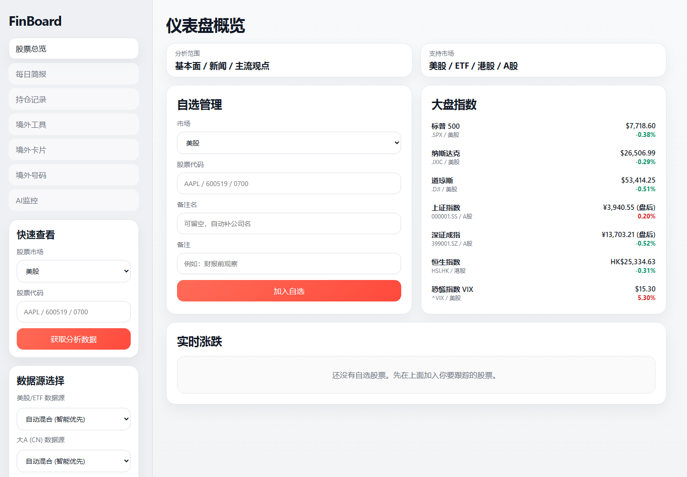
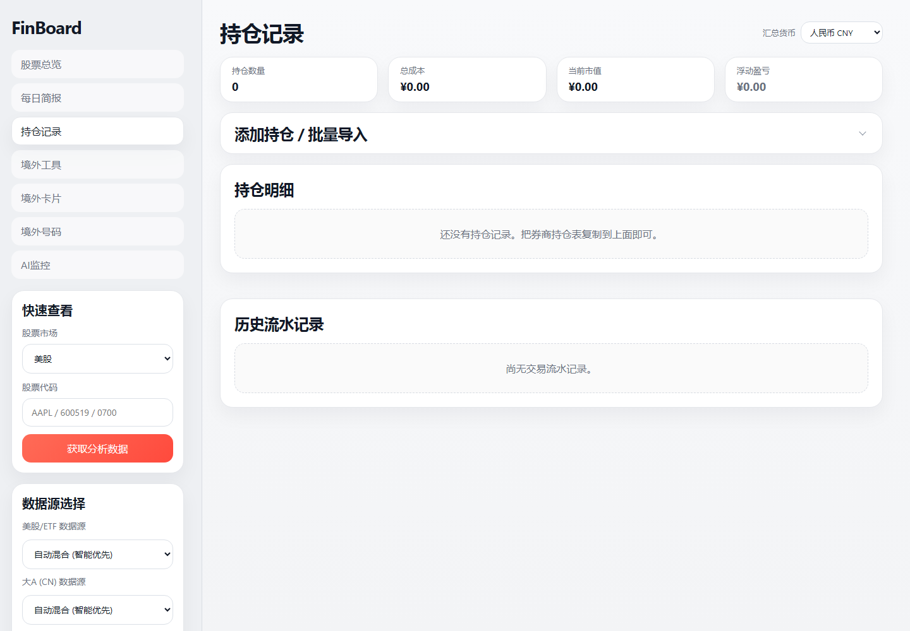
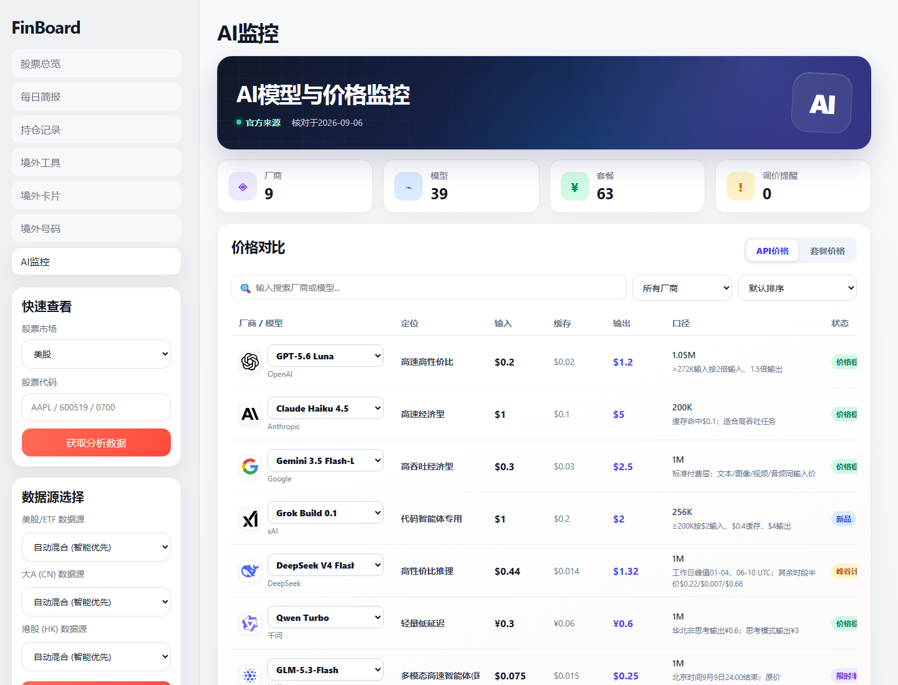

# FinBoard 项目总览

**当前版本：0.2**

FinBoard 是一个运行在 Windows 本机的股票、持仓、每日简报和境外工具管理项目。页面由 FastAPI 和 Jinja2 生成，股票与持仓数据保存在 SQLite，境外工具、卡片、号码和 AI 监控资料保存在本地 JSON 文件。项目默认仅监听 `127.0.0.1`，不应直接暴露到公网。

## 公开版运行截图

以下截图来自无个人数据的FinBoard v0.1公开环境，仅用于展示与发布。

### 股票总览



### 持仓记录



### AI监控



## 功能地图

| 页面 | 地址 | 用途 | 主要数据 |
| --- | --- | --- | --- |
| 股票总览 | `/` | 管理自选股、查看行情、进入个股分析，并提醒即将到期的境外号码 | `portfolio.db`、`phones.json` |
| 每日简报 | `/daily-briefing` | 按日期查看已导入的股票评估、分类报告和个股卡片 | `portfolio.db` |
| 持仓记录 | `/holdings` | 手动录入或批量导入持仓，记录加仓、减仓、平仓和多币种折算 | `portfolio.db` |
| 境外工具 | `/cards` | 管理境外金融软件、账户、KYC、绑定手机、注册地址和账户提供方 | `cards.json`、`card_options.json` |
| 境外卡 | `/wallet-cards` | 保存实际卡片，以卡面显示名称和末四位；点击后查看卡号、有效期、CVC、持卡人和账单地址 | `wallet_cards.json`、关联 `cards.json` |
| 境外号码 | `/phones` | 管理号码、国家、充值日期、到期日期、续费方式和过期提醒 | `phones.json`、`phone_options.json` |
| AI 监控 | `/ai-monitor` | 展示主流 AI 厂商、模型、API 价格、套餐和动态 | `ai_monitor.json` |
| 个股详情 | `/stock?symbol=...&market=...` | 查看个股基本面、新闻、主流观点和历史简报 | 外部行情源、`portfolio.db` |

## 项目目录是做什么的

```text
FinBoard/
├─ app/                 应用主体
│  ├─ routers/        各功能页面和 API 的路由
│  ├─ templates/      HTML 页面模板
│  ├─ static/css/     页面样式
│  ├─ static/js/      页面交互、表单、弹窗和分页
│  ├─ main.py         程序入口与首页
│  ├─ models.py       SQLite 数据表定义
│  ├─ services.py     行情、新闻、汇率和分析数据组装
│  ├─ providers.py    Yahoo Finance、Twelve Data、Finnhub 数据接入
│  ├─ importer.py     每日简报文件导入
│  ├─ json_store.py   JSON 文件加锁与原子写入
│  └─ utils.py        共用路径、格式化和辅助函数
├─ data/                本地数据库与 JSON 资料
│  └─ backups/        境外工具稳定片备份与恢复脚本
├─ docs/                设计说明与代码指南
├─ tests/               自动化回归测试
├─ .agents/             项目强制数据规则和工作流约束
├─ CHANGELOG.md         所有新增、修改、删除和验证记录
├─ .env.example         可选数据源和本地配置示例
├─ requirements.txt     Python 依赖版本
├─ start_local.ps1      Windows PowerShell 启动脚本
└─ start_local.bat      Windows 批处理启动入口
```

## 关键程序模块

| 文件 | 职责 |
| --- | --- |
| `app/routers/stock.py` | 个股页、实时报价、批量报价和新闻翻译接口 |
| `app/routers/portfolio.py` | 自选股、持仓导入、交易流水和仓位修改 |
| `app/routers/briefing.py` | 每日简报页、报告详情、个股卡片和刷新接口 |
| `app/routers/cards.py` | 境外工具的新增、修改、删除与选项管理 |
| `app/routers/wallet_cards.py` | 境外实卡的校验、脱敏列表、详情和编辑 |
| `app/routers/phones.py` | 境外号码的新增、修改、删除与选项管理 |
| `app/routers/ai_monitor.py` | 读取 AI 监控 JSON 并生成页面 |

## 数据文件说明

| 文件 | 内容 | 注意事项 |
| --- | --- | --- |
| `data/portfolio.db` | 自选股、持仓、交易流水、每日评估和报告 | SQLite 主数据库 |
| `data/cards.json` | 境外工具和账户资料 | 只做就地增删改，禁止全量重建 |
| `data/card_options.json` | 境外工具表单的可选项 | 由页面选项管理器维护 |
| `data/wallet_cards.json` | 实际卡号、有效期、CVC、持卡人和账单地址 | 高敏感本地数据，卡片墙只显示末四位 |
| `data/phones.json` | 境外号码、充值、到期日期和续费资料 | 首页会读取临期提醒 |
| `data/phone_options.json` | 境外号码表单选项 | 与 `phones.json` 分开保存 |
| `data/ai_monitor.json` | AI 厂商、模型、API 价格、套餐和动态 | 更新时只使用厂商官方来源 |
| `data/phone_numbers.json` | 旧版号码数据 | 当前页面使用 `phones.json`，该文件仅作历史保留 |

## 变更、记录与回滚

- 所有代码、页面、配置和数据新增/修改，都必须在本轮结束前写入 `CHANGELOG.md`。
- 每条记录需说明日期、变更文件、实际修改、原因和验证结果，作为之后定位与回滚的索引。
- `data/backups/` 是项目已有的境外工具稳定片备份；`restore_backup.py` 目前只恢复 `cards.json` 和 `card_options.json`。
- `CHANGELOG.md` 记录“改了什么”，`data/backups/` 保存“可恢复的数据文件”，两者用途不同。

## 数据源

- 默认可用：Yahoo Finance。
- 可选增强行情：Twelve Data。
- 可选增强新闻与分析师观点：Finnhub。
- 美股/ETF 优先使用已配置的增强源，失败时回退到 Yahoo Finance。
- 港股/A 股默认使用 Yahoo Finance。

## 启动方式

首次使用：

```powershell
python -m venv .venv
.\.venv\Scripts\python.exe -m pip install -r requirements.txt
.\start_local.ps1
```

或手动启动：

```powershell
cd 你的\FinBoard\目录
.\.venv\Scripts\python.exe -m uvicorn app.main:app --reload --host 127.0.0.1 --port 18010
```

打开：`http://127.0.0.1:18010`

## 本地配置

如果需要启用可选数据源，在项目根目录新建 `.env`，参考 `.env.example`：

```env
TWELVEDATA_API_KEY=你的key
FINNHUB_API_KEY=你的key
PORTFOLIO_BASE_CURRENCY=CNY
```

`.env.example` 仍保留 X/OpenAI 的旧版达人日报配置位，但当前运行时未注册达人页面路由，不属于当前可用功能。
如果每日简报不在 FinBoard 相邻目录，在 `.env` 设置 `BRIEFING_DIR`。

## 持仓导入格式

支持逗号分隔，也支持从表格直接复制粘贴：

```text
AAPL,10,182.5,US,Apple,长线
NVDA,5,119.2,US,NVIDIA,观察财报
600519,20,1680,CN,贵州茅台,白酒核心
0700,30,365,HK,腾讯控股,港股仓位
```

列顺序：`代码,数量,成本价,市场,名称,备注`，前三列必填。

## 验证方式

```powershell
cd 你的\FinBoard\目录
.\.venv\Scripts\python.exe -m unittest discover -s tests -q
```

测试主要覆盖页面路由、JSON 原子写入、持仓计算、每日简报导入和境外卡敏感信息脱敏。

## 敏感数据边界

- 境外卡列表页只输出卡号末四位，完整卡号和 CVC 只在点击详情后读取。
- 详情接口设置为不缓存，CVC 默认隐藏。
- `wallet_cards.json` 是本机敏感文件，不应上传到公开仓库、网盘或聊天群。
- `.env`、`portfolio.db`、个人 JSON、备份、日志和历史变更记录都不得进入公开仓库。
- 公开发布请使用 `scripts/export_github.ps1`生成独立脱敏副本，不要直接上传日常使用目录。

完整的安装、使用、GitHub上传和隐私检查步骤见[GitHub发布与使用指南](docs/GITHUB_PUBLISH_GUIDE.md)。
仓库目录分类见[FinBoard v0.2项目结构](docs/PROJECT_STRUCTURE.md)。
以后同步新版本时，按[FinBoard后续更新指南](docs/MAINTENANCE.md)执行测试、脱敏、差异检查与推送。
每次GitHub实际上传时间见[FinBoard上传记录](docs/UPLOAD_HISTORY.md)。


## 新页面设计入口

新增页面或修改界面前，先阅读[页面设计与复用规范](docs/DESIGN_GUIDELINES.md)。根目录[AGENTS.md](AGENTS.md)与[项目规则](.agents/AGENTS.md)均已加入提醒，统一复用间距、搜索栏、表单、弹窗、到期提醒及本地图标。
